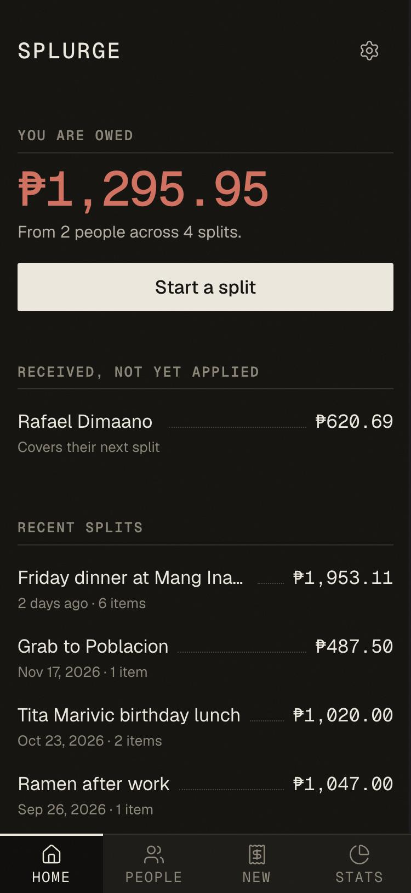
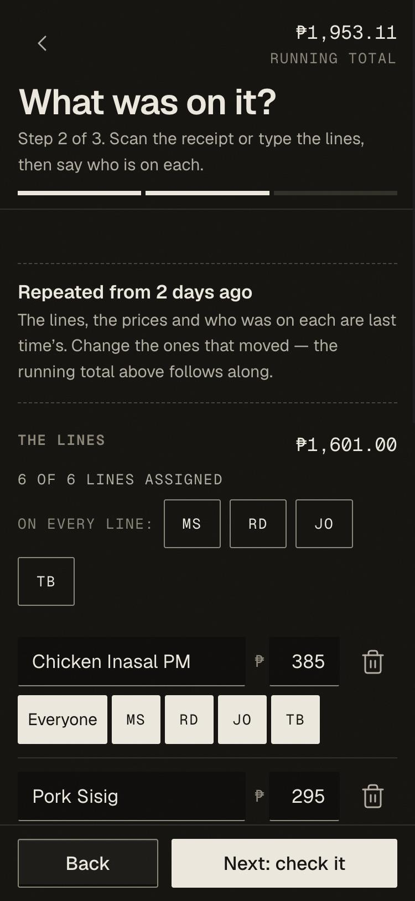
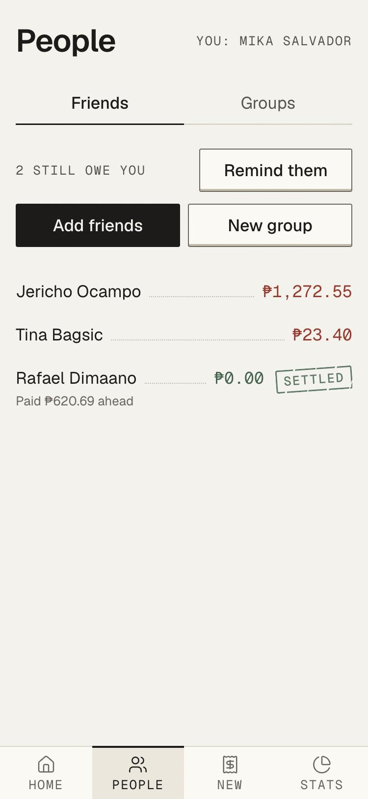
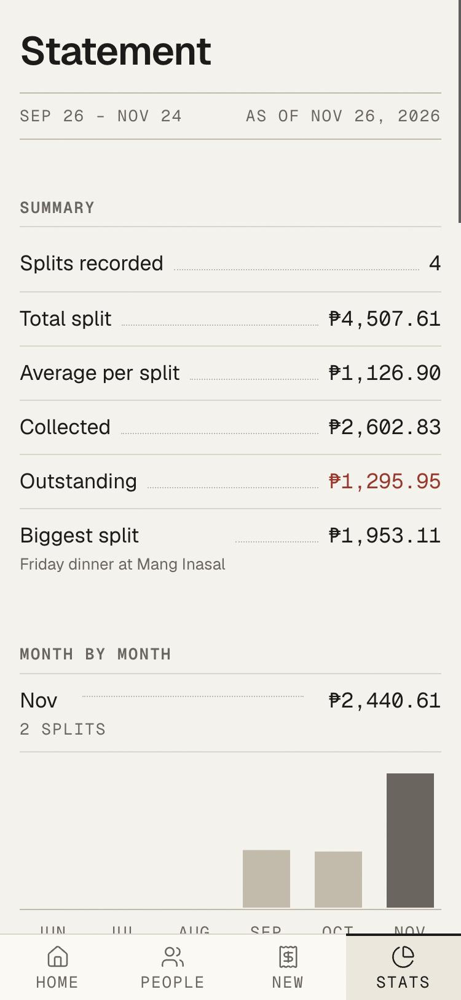

# Splurge

**Scan the receipt. Split it line by line. Get paid back.**

A mobile-first bill-splitting PWA for the way group dinners actually get paid for — one person fronts the whole bill, and everyone settles up afterwards.

**Live:** [koala3353.github.io/splurge](https://koala3353.github.io/splurge/)

Everything lives on your device. No account, no backend, no server that can see what you spent.

|  |  |
|---|---|
|  |  |
| **What you are owed.** Figures are monospaced and right-aligned, dotted leaders bind each split to its total, and money received but not yet applied is surfaced rather than silently absorbed. | **Splitting the lines.** Repeating a bill brings last time's lines, prices and assignments back. Each line carries a strip of initial toggles you can drag across; the running total follows along. |
|  |  |
| **Who owes you.** Sorted by balance, settled friends dropping to the bottom under a stamp. Note ₱1,272.55 and ₱23.40 — shares are allocated in whole centavos, so the parts always sum to the whole. | **The statement.** Not a dashboard: a printed statement. Ruled rows, a monthly ledger, and plain-CSS charts that answer to hover, tap and keyboard. |

---

## What it does

**Split a bill**
- **Scan the receipt** — Tesseract.js OCR pulls out line items and prices, correcting for angle, shadow and uneven lighting first. It recovers about 57% of line items on real receipt photographs, so it is an assist, not an oracle — the interface is built so correcting it is expected and cheap.
- **Assign line by line** — a strip of initial toggles per line that you can drag across, a one-tap "same as the line above", and a chip that puts someone on every line at once. A 6-item, 4-person dinner is **21 taps**; assignment itself is 2.
- **Or don't** — "Split one amount evenly" is a 5-tap route on step one, for when nobody wants an itemised anything.
- **Tip and fees** — tip as a percentage of the subtotal with presets; fees, service charges and discounts allocated proportionally to each person's share.
- **The money always adds up.** Shares are allocated in integer centavos by largest remainder, so ₱10 split three ways is ₱3.34 / ₱3.33 / ₱3.33 — never three ₱3.33s under a ₱10.00 headline. A property test over 400 generated assignments asserts `Σ dues === total`, exactly.

**Get paid back**
- **People and balances** — who owes you, sorted by balance, settled friends dropping to the bottom with a `SETTLED` stamp. Record full, half or custom payments; undo any of them.
- **Send a reminder** — a message that reads like you wrote it, straight into WhatsApp, Messenger or SMS via the native share sheet. One person at a time, or everyone at once.
- **Know when you last asked.** The app records a nudge only when it actually sends, so "Reminded 9 days ago" is true. Nobody double-chases a friend by accident.
- **Share the split as a receipt image** — a PNG that looks like printed paper, built for posting into the group chat. First names only; your payment number stays off unless you turn it on for that send.

**Stop repeating yourself**
- **Split again** — the splits you keep making come back as one-tap chips, ranked by recency, repeat count and time of day. An itemised bill reopens prefilled; a single amount just splits. The chip tells you which.
- **Your usual crew** — mark a partner or a barkada as your default and step one starts with them already selected, stated in words, one tap to drop.
- **Recurring splits** — rent monthly, groceries weekly. It offers; it never invents a bill you did not confirm.
- **Groups**, saved templates, and remembered tip percentage.

**Understand your money**
- Outings, total split, collected, outstanding, month by month.
- **How long people take to pay you** — median days to settle, overall and per person.
- **Who settles first**, which is a different question from who settles fastest.
- **Who you have to chase**, ranked by age rather than amount, with the oldest outstanding debt headlined.
- Charts are plain CSS — no charting dependency — and respond to hover, tap and keyboard alike.
- Statistics are withheld until there is enough data to mean anything. A person with one settled split is not "your fastest payer", and the page says what it is waiting for instead of showing a number it cannot support.

**Everywhere**
- Installs to the home screen, works offline, handles notched safe areas, deep links survive a hard refresh.
- Light and dark, following the OS with a manual override.
- 12 currencies. Changing it changes how amounts are displayed; it does not convert them, and the app says so.
- Export and restore a JSON backup. Destructive actions are undoable, not merely confirmed.

---

## Design

The interface is **receipt paper**: a bill splitter that looks like a bill. A narrow column, monospaced figures in a right-aligned money column, dotted leaders running from each item to its price, hairline rules instead of boxes, and rubber stamps instead of status pills.

Two rules carry it:

- **One accent, and it is a stamp.** `--stamp` marks money you are owed and the stamp mark itself. Nothing else. Chrome is ink and rules.
- **Money is ink until it has a state.** An amount is `--ink` by default, turns `--stamp` when owed and `--ledger` when settled. No other element may use either colour.

Dark is designed first — the app opens at a restaurant table at night — and light is the settling-up-at-a-desk scene. Neither is a tinted inversion of the other.

Tokens are declared in three layers across `src/styles/`, inside an explicit `@layer tokens, base, components, utilities` cascade. That ordering is load-bearing rather than tidy: an earlier version's accessibility adaptations targeted bare `:root` while its light-theme layers were more specific, so **every light-mode adaptation was silently dead**. Layers make that class of bug impossible. The stylesheet ships zero `!important`.

Full contract, and why this direction replaced the last one: **[DESIGN.md](DESIGN.md)**.

---

## Receipt scanning, measured

The parser used to be validated only against synthetic fixtures. It passed. Against real photographs it was recovering roughly **one line item in eight**.

`npm run ocr-eval` now scores the real pipeline against [CORD-v2](https://huggingface.co/datasets/naver-clova-ix/cord-v2) (CC BY 4.0) using two disjoint 60-receipt slices — tuned on one, confirmed on an untouched holdout.

| metric | original | now (dev) | now (holdout) |
|---|---|---|---|
| line-item recall | 12.5% | **56.6%** | **56.7%** |
| line-item F1 | 17.4% | **59.7%** | **60.1%** |
| strict (name + price) F1 | 11.9% | **50.7%** | **52.2%** |
| price attachment | 68.4% | 84.9% | 86.8% |
| receipts yielding nothing | — | 5 / 60 | 4 / 60 |
| mean scan time | 7.06s | 3.48s | 3.04s |

**What moved it.** A price-column detector that clusters each amount's *last* digit, a guard against garbled summary labels (`TOVAL`, `lotal`, `CRANDTOTAL`) entering the item list carrying the bill total as a price, joining a name to an amount on the following line — and, worth more than all three combined, **illumination flattening**. The binarizer was already local, but the crop, paper-quad and orientation probes each ran a *global* Otsu, which under shade splits the lit half from the shaded half rather than the paper from the table.

**Honest caveats.**
- ~57% recall means the scanner saves you most of the typing, not all of it. Correcting it is a designed path, not an error state.
- **Engine confidence does not predict extraction accuracy.** A high-confidence scan is not a correct one. Nothing in the app branches on it, and the UI reports confidence as information about the *image*, never as a guarantee about the *numbers*.
- CORD-v2 is Indonesian. Philippine receipts are close but not identical.
- CORD's photographs are too clean to exercise heavy shadow or extreme angle — measured correlations between image quality and accuracy are near zero. `scripts/ocr-eval/synthetic.mjs` tests those separately with generated distortions, and its results are labelled synthetic and never mixed with corpus numbers. Illumination flattening helps smooth shadow and thermal fade, and currently *hurts* hard-edged shade, where a box blur leaves a halo.

Drop your own labelled receipts into the harness for a number that reflects your actual receipts.

---

## Tech

- **React 19 + Vite**, React Router with a shared `AppLayout`
- **State:** React Context + `localStorage`, with cross-tab sync
- **Styling:** hand-rolled CSS — layered tokens, native `<dialog>`, no framework
- **Type:** Geist and Geist Mono
- **OCR:** Tesseract.js, lazy-loaded so it costs nothing until you scan
- **Charts:** plain CSS, no dependency
- **Tests:** Node's built-in runner — no test framework dependency

Production bundle: 128 KB gzipped.

## Running it

```bash
npm install
```

```bash
npm run dev
```

```bash
npm test
```

```bash
npm run build
```

Quality gates, all of which run in CI before the build so a failure blocks the deploy:

```bash
npm test && npm run lint && node scripts/check-contrast.mjs
```

The contrast script composites the real layers and measures every shipping foreground/background pair against WCAG AA in both themes. It exists because a retheme once shipped white-on-emerald CTAs at 2.28:1 — and then nothing ran it, while the stylesheet shipped a hardcoded `color: white` on danger buttons at 2.69:1 that the script could not see, because it measured a token no component used. It now checks the values components actually use.

Scoring the receipt parser needs the corpus fetched first, and a native canvas
for the pipeline to draw on under Node. That canvas is deliberately **not** a
dependency of the app — CI should not build a platform binary for a script it
never runs — so install it only when you want to score the parser. See
[`scripts/ocr-eval/README.md`](scripts/ocr-eval/README.md).

```bash
npm i -D @napi-rs/canvas && npm run ocr-eval
```

## Architecture

- `src/utils/split.js` — the only money maths in the app. Integer centavos, largest-remainder allocation. Used by the store, the review screen and the share text, so the numbers cannot disagree.
- `src/utils/settlement.js` — FIFO payment allocation and derived balances, extracted so it can be tested directly.
- `src/utils/stats.js` — pure, dependency-free derived figures, each pinnable by a test.
- `src/utils/suggestions.js` — ranks repeat splits from history and templates.
- `src/utils/ocr/` + `receipt.js` — preprocessing, geometry, line rebuilding, parsing.
- `src/utils/receipt-image/` — the canvas renderer for the shareable PNG.
- `src/components/ui/` — the primitives everything else is built from: `Sheet`, `Button`, `Field`, `Row`, `Leader`, `Stamp`.
- `src/store/AppContext.jsx` — people, groups, bills, payments, templates, derived balances, self-identity, backup and restore.

Backups are versioned (currently v5) and older ones restore cleanly without inventing data the format did not have.

## Deployment

Pushing to `main` runs the quality gates, builds, and publishes to GitHub Pages. A generated `404.html` copy of the app shell lets client-side routes survive a hard refresh. The service worker precaches the hashed bundle and prompts you to reload when a new version is ready.

## Known gaps

- Tesseract's WASM and language data load from a CDN, so the **first** scan needs a connection even though the rest of the app works offline.
- Google Fonts is a third-party request, and the service worker cannot cache opaque cross-origin responses — offline sessions fall back to system faces.
- There is **no sync**. The app assumes one device; moving to another means exporting and restoring a backup.
- The app assumes **you** front the bill. There is no way to record that a friend paid for one, so debts only ever point one direction.
